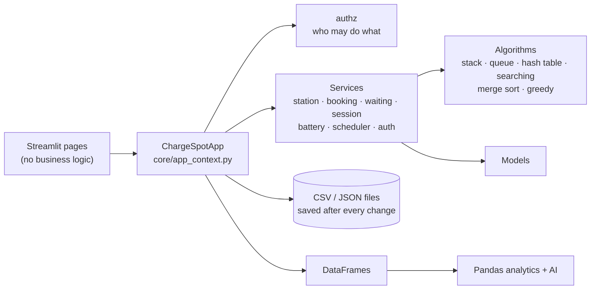
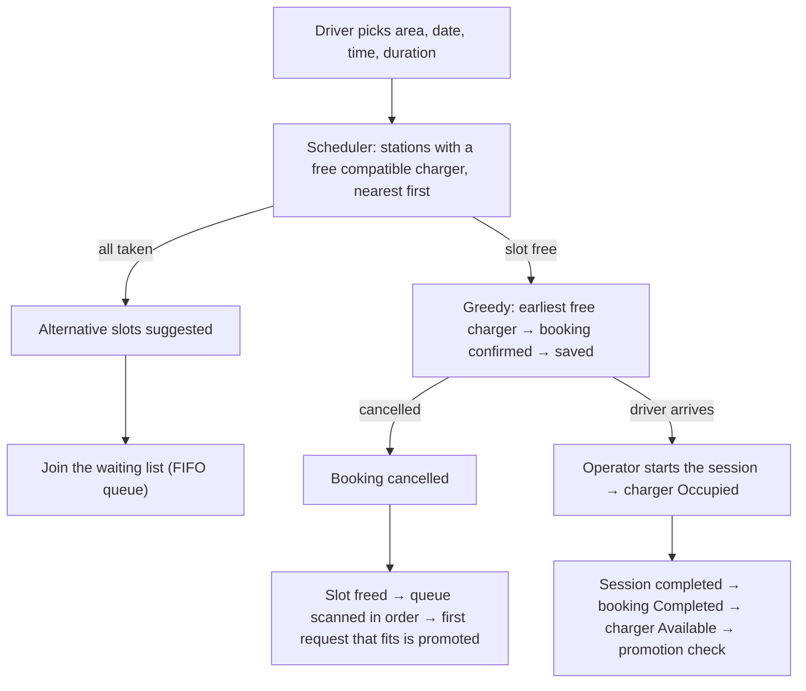

<div align="center">

# ⚡ ChargeSpot

### Find, book and manage EV charging, with a fair waiting list, live sessions, and a data + AI analytics layer.

[](https://chargespot.streamlit.app/)


**Graduation project, Samsung Innovation Campus (SIC 8) · Coding and Programming**
*In collaboration with Life Makers Foundation*

[**🚀 Live demo**](https://chargespot.streamlit.app/) · [Features](#-features) · [Quick start](#-quick-start) · [Architecture](#-architecture) · [AI & analytics](#-analytics-and-ai) · [Team](#-team)

</div>

---

## 📑 Table of contents

- [Overview](#-overview)
- [Features](#-features)
- [Live demo and demo accounts](#-live-demo-and-demo-accounts)
- [Quick start](#-quick-start)
- [Roles and permissions](#-roles-and-permissions)
- [Architecture](#-architecture)
- [Project structure](#-project-structure)
- [Data structures and algorithms](#-data-structures-and-algorithms)
- [Analytics and AI](#-analytics-and-ai)
- [Authentication and security](#-authentication-and-security)
- [Configuration](#-configuration)
- [Testing](#-testing)
- [Data](#-data)
- [Known limitations](#-known-limitations)
- [Team](#-team)
- [Acknowledgments](#-acknowledgments)

---

## 📖 Overview

EV drivers arrive at a station and find every charger busy. Operators juggle bookings by hand. Managers cannot see which stations are overloaded and which sit idle.

**ChargeSpot** is a Streamlit application that solves this for a network of **16 stations and 56 chargers** across Cairo and Alexandria:

- **Drivers** reserve a *compatible* charger without double-booking, and queue fairly when everything is taken.
- **Operators** run the charging sessions and manage the waiting list.
- **Administrators** manage the network and study demand, utilization, and cancellations through an analytics dashboard with forecasting, recommendations, optimization, and predictive maintenance.

> ⚠️ **All data is simulated.** No real chargers, vehicles, or people are connected. Station coordinates are approximate and used only for the map.

---

## ✨ Features

| Area | What it does |
| --- | --- |
| 🔌 **Stations & chargers** | AC / DC chargers, three connector types, status, search and filters, add / edit / remove with **Undo** |
| 📅 **Smart booking** | No overlaps *per charger*, connector compatibility, opening hours, nearest-available-station greedy choice, alternative slots |
| ⏳ **Fair waiting list** | FIFO queue with live positions; a freed slot goes automatically to the driver who has waited longest |
| 🔋 **Charging sessions** | Planned vs actual time, simulated energy, charger status follows the session, history sorted by our own Merge Sort |
| 🚗 **Driver dashboard** | Bookings, queue position, session history, **battery monitor** (range and charging-time *estimates*) |
| 📊 **Admin analytics** | Cleaning report, KPIs, generated insights, demand heatmap, station map, 15+ charts, CSV export |
| 🤖 **AI features** | Demand forecast, English / Arabic assistant, optional LLM rewording, station recommendation, scheduling optimizer, predictive maintenance |
| 🔐 **Accounts & roles** | Login, e-mail verification, password reset, three roles, permissions enforced in the application layer |
| 🧪 **Algorithm Lab** | Measures every data structure and algorithm live on the real data |

<!--
SCREENSHOTS: add your images to docs/screenshots/ and uncomment this section.

## 🖼️ Screenshots

| Bookings (Driver) | Waiting List (Driver) |
| :---: | :---: |
|  |  |

| Admin Analytics | Algorithm Lab |
| :---: | :---: |
|  |  |
-->

---

## 🌐 Live demo and demo accounts

**▶ [chargespot.streamlit.app](https://chargespot.streamlit.app/)**

The app may take a few seconds to wake up if it has been idle. Use these demo accounts (fake people, already verified):

| Role | E-mail | Password |
| --- | --- | --- |
| 🛠️ Administrator | `admin@chargespot.com` | `Admin1234` |
| 🔧 Station Operator | `operator@chargespot.com` | `Operator1234` |
| 🚗 Driver | `ahmed@gmail.com` | `123456789` |

---

## 🚀 Quick start

```bash
git clone https://github.com/Amratef0/Chargespot.git
cd Chargespot

python -m venv .venv
source .venv/bin/activate            # Windows: .venv\Scripts\activate
pip install -r requirements.txt
streamlit run app.py
```

The simulated history ships in `data/`. If you delete `data/*.csv`, it is regenerated on the next start (about 30 s).

### Trying registration without a mail server

New accounts must verify their e-mail address before the first login. With no mail server configured, messages are only written to `data/outbox/`, so a new user could never log in. For a local demo, show the "mailbox" on the login screen instead:

```bash
# macOS / Linux
CHARGESPOT_DEV_MAILBOX=1 streamlit run app.py

# Windows PowerShell
$env:CHARGESPOT_DEV_MAILBOX=1; streamlit run app.py
```

Register, copy the code from the *Development mailbox* box, paste it in **Verify e-mail**, then log in.

> 🚫 **Never enable this setting on a public server.** It shows everybody's verification and reset codes.

---

## 👥 Roles and permissions

Defined once in `models/user.py` (`permissions()`); the menu and every page read the same table (`services/authz.py`).

| Permission | 🚗 Driver | 🔧 Operator | 🛠️ Admin |
| --- | :---: | :---: | :---: |
| Book, cancel own booking, join waiting list, battery monitor | ✅ | | |
| Smart recommendation | ✅ | ✅ | ✅ |
| View stations | ✅ | ✅ | ✅ |
| Start / complete sessions, set charger status, manage the waiting list, see all bookings | | ✅ | ✅ |
| Add / edit / remove stations and chargers, Undo, cancel any booking, view any driver, analytics, Algorithm Lab | | | ✅ |

---

## 🧩 Architecture



**A booking, end to end**



**State handling:** `st.cache_resource` holds **one shared app** per server process (every change is written to CSV/JSON immediately, so it survives a restart); `st.session_state` holds who is logged in in each browser tab.

---

## 🗂️ Project structure

```
app.py                  login / register / verify / reset + role-based navigation
models/                 Station, Charger (AC/DC), Booking, ChargingSession, User roles, exceptions
algorithms/             stack, queue, hash_table, sorting (merge sort), searching, interval_utils, greedy_scheduler
services/               station, booking, waiting, scheduler, session, battery,
                        auth, authz, token_service, login_session_service, mailer
utils/                  validators (regex), storage (atomic JSON)
core/                   app_context (wires everything), state, browser_session, schema, data_store, ui
analytics/              cleaning, metrics, charts, insights, scheduling_optimizer, algorithm_lab, search_experiment
ai/                     forecast, analytics_assistant, llm_wording, recommendation, predictive_maintenance
pages/                  the 9 Streamlit pages
data/                   stations.json, distances.json, simulated history, generator, catalog builder
tests/                  325 automated tests
docs/                   audit, changes, checklist, algorithms, schema, auth, demo script
legacy/                 the team's original files, untouched (for comparison)
```

---

## 🧠 Data structures and algorithms

All written by the team (no built-in sort or search in the required parts). Full explanations in [`docs/ALGORITHMS.md`](docs/ALGORITHMS.md); the **Algorithm Lab** page measures them live.

| Structure / algorithm | Used for | Measured on the real data |
| --- | --- | --- |
| **Stack** | Undo of every administrator change | LIFO, O(1) |
| **Queue** (FIFO) | Waiting list, positions, promotion | O(1) enqueue / dequeue |
| **Hash table** (chaining) | ID registries of stations, chargers, bookings | Finding booking #28 255: **1** comparison |
| **Binary search** | Overlap check on a charger's sorted busy list; booking lookup | Same lookup: **13** comparisons (sequential: 28 255) |
| **Sequential search** | Station-name search (unsorted) | O(n) |
| **Merge Sort** | Session history, booking lists | 2 000 items: **19 452** comparisons (bubble sort: 1 998 769) |
| **Greedy** | Earliest free slot on the best compatible charger | Counter-example in the app: 270 min of waiting vs 90 for the best order |

**Overlap rule:** two bookings conflict if `A.start < B.end and B.start < A.end`; back-to-back bookings are allowed.

---

## 📊 Analytics and AI

Available to administrators on the **Admin Analytics** page.

### Data analytics

- **Cleaning pipeline** with a defect report: tested on a messy file with 11 injected defect types, and every one is detected exactly.
- **KPIs and insights generated from the data** (nothing hard-coded), demand heatmap and trend, station map, CSV export.
- **Bring your own data:** upload a bookings CSV and the dashboard works on it.

### AI / ML / LLM

| Feature | How it works |
| --- | --- |
| **Demand forecast** | Gradient boosting (`HistGradientBoostingRegressor`) predicts bookings per station per hour, 1-7 days ahead. Features are all known in advance (cyclical hour, weekday, weekend, station, same-hour demand 7 days earlier, 7-day station average), so there is **no data leakage**. Evaluated on a hold-out period against a naive and a seasonal-average baseline, and it must beat both. |
| **Analytics assistant** | Rule-based, bilingual (English / Arabic). Answers peak hours, busiest / least-used stations, cancellations, waiting time, revenue, energy, weekends, and delays using **only numbers computed from the data**, so it cannot invent a figure. Works offline. |
| **LLM wording layer** | *Optional, off by default.* An LLM may only **rephrase** the assistant's answer. Every number in the rewrite must match the original; otherwise the original answer is shown. Any failure (no key, timeout, HTTP error) falls back safely. Only the question and the aggregated answer text are sent, never booking rows or driver names. |
| **Smart recommendation** | Explainable weighted score over distance, expected wait, price, power, and availability, on absolute scales. Expected wait comes from historical waits at the same station and connector within ±1 hour. Excluded stations are listed with the reason. |
| **Scheduling optimizer** | Compares FCFS, shortest-first, earliest-desired, best heuristic, local search, and exact backtracking to measure how much waiting time better scheduling could save. |
| **Predictive maintenance** | Compares each charger's recent window with **its own** earlier reference window (power drop, error increase, temperature rise) and produces a 0-100 risk score with High / Medium / Low levels. The Medium threshold was chosen by a threshold sweep over 60 simulated fleets. |

> **Honest evaluation:** the data is synthetic, so forecast and maintenance results show that the *method* works, not real-world accuracy. The optimizer is an offline analysis (it assumes all requests are known), so its 12-32 % saving is an upper bound.

---

## 🔐 Authentication and security

- **Passwords:** salted PBKDF2-SHA256 (100 000 iterations); one error message for "wrong password" and "unknown e-mail".
- **E-mail verification and forgot password:** single-use tokens stored only as SHA-256 hashes (24 h / 30 min expiry); at most 3 reset e-mails per address per hour; a password reset logs the account out everywhere.
- **Login survives a refresh:** random opaque token in a cookie, validated by the server on every run (idle timeout 2 h, absolute 12 h; logout and reset take effect immediately).
- **Authorization in the application layer:** every state-changing method of `ChargeSpotApp` takes the acting user and checks the permission first, so the rules hold for any caller, not only for pages.

Details: [`docs/AUTH.md`](docs/AUTH.md).

### Known security gaps

Found in our own review and **not fixed yet**. Fix these before any production deployment:

| Gap | Why it matters |
| --- | --- |
| No limit on failed logins | Passwords can be guessed without delay |
| An unknown e-mail answers faster (≈0 ms) than a known one (≈100 ms) | Lets an attacker enumerate registered e-mails |
| An unverified account can be created for **someone else's** address | "Pre-hijacking": if the owner then verifies, the creator's password works |
| SMTP connections do not verify the server certificate | Credentials and reset links could be intercepted |
| National ID and phone stored unencrypted in `users.json` (git-ignored) | Personal data at rest |
| Session cookie is set by JavaScript (not `HttpOnly`) | Readable by scripts on the page |
| Demo credentials are shown on the login screen | Remove before deployment |

---

## ⚙️ Configuration

Everything is optional; the defaults work for a local demo.

| Variable | Meaning |
| --- | --- |
| `CHARGESPOT_DATA_DIR` | Use another data folder |
| `CHARGESPOT_SMTP_HOST`, `_PORT` (587 STARTTLS / 465 SSL), `_USER`, `_PASSWORD` | Real e-mail (Gmail: use an *app password*) |
| `CHARGESPOT_MAIL_FROM`, `CHARGESPOT_BASE_URL` | Sender address; public URL used in e-mail links |
| `CHARGESPOT_DEV_MAILBOX=1` | No SMTP: show e-mails on the login screen (**local demo only**) |
| `GEMINI_API_KEY` (or `GOOGLE_API_KEY`) | Enables the optional LLM rewording of the assistant's answers |
| `CHARGESPOT_LLM_MODEL` | Override the default Gemini model |

Secrets go in the environment or in `.streamlit/secrets.toml` (git-ignored). **Never commit them.**

---

## 🧪 Testing

```bash
python -m pytest            # 325 tests, about 1.5 minutes
```

| Area | Tests |
| --- | --- |
| Data structures and algorithms | 34 |
| Services (booking, waiting, scheduler, stations, sessions, battery, auth) | 53 |
| End-to-end flows with files on disk and restarts | 19 |
| E-mail verification and login sessions / authorization | 20 / 23 |
| Streamlit pages with real logins / full user journeys | 45 / 6 |
| Pandas cleaning, metrics, generator | 15 / 10 / 9 |
| AI: forecast, assistant, recommendation, optimizer, maintenance, LLM wording | 5 / 20 / 22 / 20 / 16 |
| Search experiment | 8 |

The page tests check **behaviour and structure**, not how the pages look.

---

## 🗃️ Data

120 days of **simulated history** (to 2026-10-13): ~28 000 bookings, ~22 600 sessions, 300 drivers, and 9 vehicle models, with:

- rush-hour peaks and a different Friday / Saturday pattern,
- popular and quiet stations,
- shifted, queued, cancelled, and no-show bookings.

Every booking made in the app is added to the same files. The station catalog merges the team's two original catalogs; chargers, prices, and coordinates for stations 2-16 were added during integration (the original data had chargers for one station only). Formats: [`docs/SCHEMA.md`](docs/SCHEMA.md).

---

## ⚠️ Known limitations

- One server process shares one app object: fine for a demo, not for several servers.
- A vehicle is "compatible" with a charger when their connector types are equal; all stations are open 24 h; times have no time zone.
- The cookie helper uses `st.components.v1.html`, which Streamlit has announced it will remove. Tested with Streamlit 1.65: keep that version (or migrate to `st.iframe`) before upgrading.
- Tested on Python 3.12 (pandas 3.0, scikit-learn 1.8, plotly 7.1).

---

## 📚 Documentation

| File | Content |
| --- | --- |
| [`docs/REQUIREMENTS_CHECKLIST.md`](docs/REQUIREMENTS_CHECKLIST.md) | Every SIC 8 requirement → where it is → the test that proves it |
| [`docs/ALGORITHMS.md`](docs/ALGORITHMS.md) | Purpose, input, output, workflow, complexity, limits, justification |
| [`docs/AUTH.md`](docs/AUTH.md) | Roles, sessions, verification, password reset, e-mail setup |
| [`docs/SCHEMA.md`](docs/SCHEMA.md) | IDs, formats, files |
| [`docs/TEAM_AUDIT.md`](docs/TEAM_AUDIT.md) | What was wrong in the first version, with evidence |
| [`docs/TEAM_CHANGES.md`](docs/TEAM_CHANGES.md) | What changed per member |
| [`docs/EDGE_CASE_TESTING_NOTES.md`](docs/EDGE_CASE_TESTING_NOTES.md) | Edge cases and the tests that cover them |
| [`docs/DEMO_SCRIPT_AND_DEFENSE_QA.md`](docs/DEMO_SCRIPT_AND_DEFENSE_QA.md) | 8-10 minute demo flow and likely questions |

---

## 👨‍💻 Team

| Member | Owns |
| --- | --- |
| **Member 1** | Stations, chargers, hash table, stack, sequential search, validation |
| **Member 2** | Bookings, waiting list, queue, greedy scheduling, binary search |
| **Member 3** | Charging sessions, battery monitor, Merge Sort, exceptions |
| **[Amr Atef](https://github.com/Amratef0)** | Data, analytics, AI features, integration, authentication |

Team members: Amr Atef, Ahmed Mahmoud, Bishoy Emeil, Malak Ghandour.

---

## 🙏 Acknowledgments

Special thanks to our Project Manager **Omar Emad**, and to our instructors **Ahmed Medhat** and **Ahmed Maher Elmoazen** for their guidance throughout the program.

Thank you to the whole **Samsung Innovation Campus** team, **Dina Nabil, Shorok Mohamed, Fatma Ibrahim, Ahmed Bar, Mohamed Sameh and Toqa Khaled**, and to **Life Makers Foundation** for making this journey possible.

---

<div align="center">

Built for the **Samsung Innovation Campus, SIC 8** graduation project, in collaboration with **Life Makers Foundation**.
Educational use · all data is simulated.

</div>
